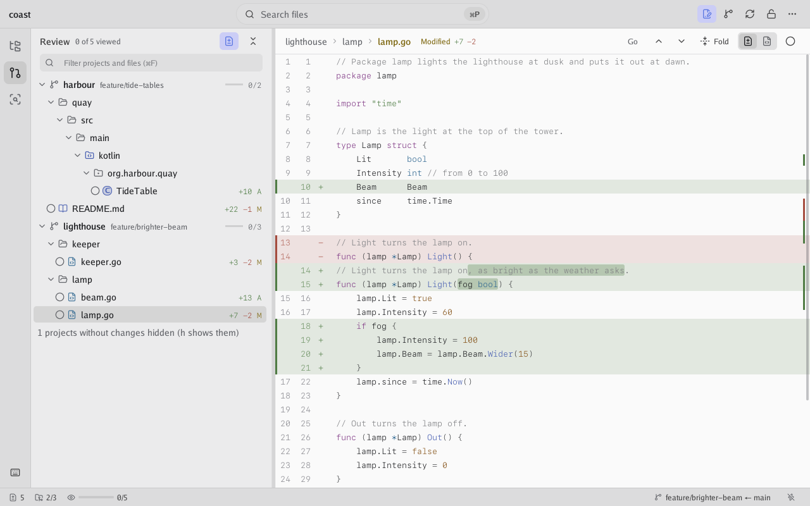
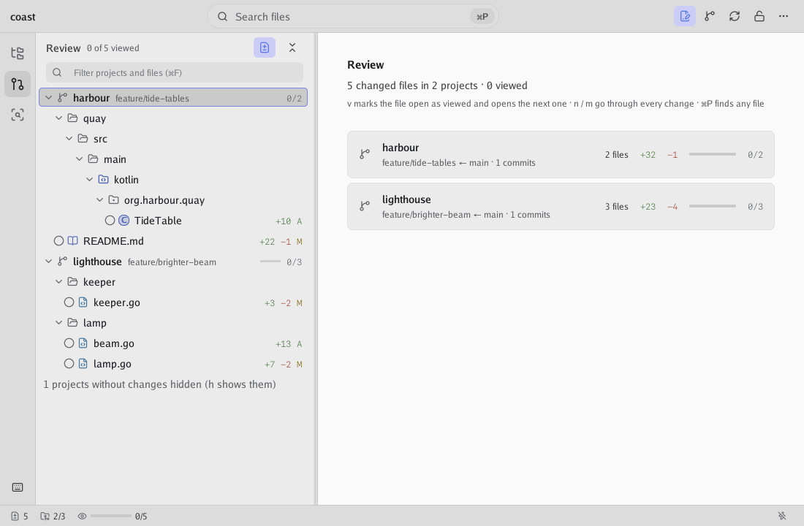
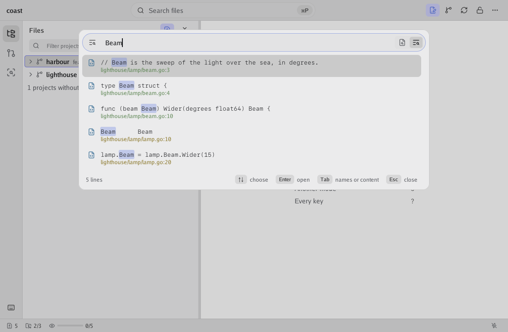
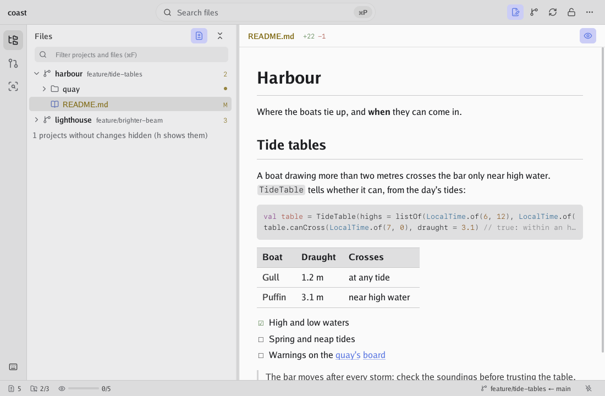
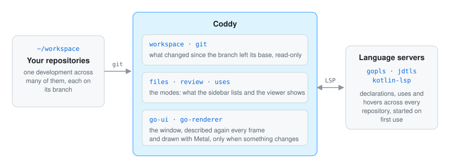

<p align="center"></p>

<div align="center">

# Coddy

**A small, fast code reader for developments that change many repositories at once.**
Open a folder of projects, see which ones a development changed against their base branch, and
read each changed file's diff, coloured, without leaving the keyboard. Fix what you find as you
read, follow names across repositories with their language servers, or lock it and only read.

[](go.mod)


[](LICENSE)

</div>

## 🤖 AI disclosure

I write most of my code by hand, so I want to be clear about where AI was used here.

- **Written by an AI assistant (Claude, by Anthropic) under my direction, since November 2026:**
  all of it so far: the reader, its modes and panes, the editing, the language servers, the uses
  mode and its graphs, the Markdown view, the tests and the docs.

Commits made with AI carry a `Co-Authored-By: Claude` line.

**Status: pending thorough review.**

> ⚠️ **Warning:** an experiment, **not suitable for production use**. It only reads git, but it
> edits files when you ask it to.

---

<p align="center">
<picture>
  <source media="(prefers-color-scheme: dark)" srcset="docs/images/hero-dark.png">
  
</picture>
</p>

## ✨ What it looks like

<table>
<tr>
<th width="33%">The whole development</th>
<th width="33%">Find anything</th>
<th width="33%">Markdown, formatted</th>
</tr>
<tr>
<td>
<picture>
  <source media="(prefers-color-scheme: dark)" srcset="docs/images/overview-dark.png">
  
</picture>
</td>
<td>
<picture>
  <source media="(prefers-color-scheme: dark)" srcset="docs/images/finder-dark.png">
  
</picture>
</td>
<td>
<picture>
  <source media="(prefers-color-scheme: dark)" srcset="docs/images/markdown-dark.png">
  
</picture>
</td>
</tr>
<tr>
<td>Each project's branch against its base, measured from where it left it; files marked viewed as you go.</td>
<td>A file by its name or a line by its text, in every project at once, changed files first.</td>
<td>Headings, lists, tables and coloured code; the eye in the header shows the text, to edit it.</td>
</tr>
<tr>
<td colspan="3" align="center">Zed's One colours, light and dark, and keys that follow IntelliJ's macOS keymap. All of it is a made-up workspace, captured with <code>-capture</code>.</td>
</tr>
</table>

## 🚀 Quick start

```bash
go build -o bin/code-review ./cmd/code-review
./bin/code-review ~/workspace                    # a folder of repositories
./bin/code-review ../api ../web                  # or the repositories themselves
./bin/code-review -review -base origin/release/2.4 ~/workspace
go vet ./... && go test ./...                    # the interface tests drive the window with no display
```

It needs Go 1.25 or later and the Xcode command line tools: the window is opened through cgo and
drawn with Metal. `gopls`, `jdtls` and `kotlin-lsp`, when they are on the `PATH`, start the first
time a file of their language opens. `?` lists every key.

[More on getting started →](docs/2-get-started.md)

## 🔍 How it works

<p align="center">
  
</p>

Git is only read: a handful of plumbing commands, no fetch, no commit, no checkout. Files are
written only when you save them, and what a language server writes in a repository is shown
apart from your changes. The window is [Go UI](https://github.com/akrck02/go-ui) over
[Go Renderer](https://github.com/akrck02/go-renderer), dressed in
[Bubble](https://github.com/akrck02/bubble)'s shapes; code is coloured with
[chroma](https://github.com/alecthomas/chroma). [More on how it is made →](docs/4-how-it-is-made.md)

## 🎯 Goals

* **Review a development as a whole:** one branch across twenty repositories reads as one change.
* **Stay on the keyboard:** every command has a key, and the keys are the ones IntelliJ taught.
* **Leave nothing behind:** no files in the repositories, no daemons, no idle memory.

## 📚 Documentation

| | |
|---|---|
| [What it does](docs/1-features.md) | The modes, the diff, editing, language servers, the uses mode, the design, what is not done yet. |
| [Get started](docs/2-get-started.md) | Building, running and every flag. |
| [Keys](docs/3-keys.md) | Every key, in each mode and while editing. |
| [How it is made](docs/4-how-it-is-made.md) | The packages and how the window is drawn. |
| [Contributing](docs/8-contributing.md) | The one rule, where things are, adding a mode, building and testing, proposing a change. |
| [Proposals](docs/proposals) | Each change as it was proposed, approved and tried. |

## Licence

MIT, see [LICENSE](LICENSE).
